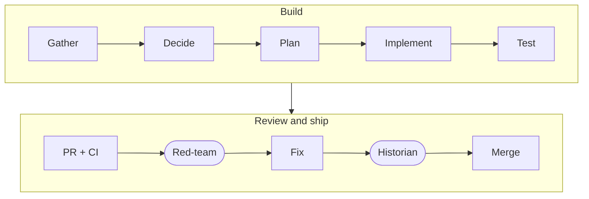

<!-- Profile README: lives in the public repo MatheusCastro99/MatheusCastro99 -->

<div align="center">

<!-- Header: generated with capsule-render, then edited for the two-line subtitle -->


<a href="https://github.com/MatheusCastro99">
  
</a>


</div>

---

## `> whoami`

```csharp
public class Matheus : Developer
{
    public string   Location   => "Fort Bragg, NC";
    public string   Training   => "Microsoft Software & Systems Academy (MSSA) · Cloud Application Development";
    public string   Background => "US Army ADA Systems Operator, transitioning · Active TS/SCI";
    public string[] Focus      => ["C# / .NET", "Azure", ".NET MAUI", "MERN", "Agentic development"];
    public string   Approach   => "The agent recommends with trade-offs. I decide.";

    public string Status() => "Open to software engineering opportunities.";
}
```

---

## `> ls ./skills`

<div align="center">


<br/>


<br/>


</div>

---

## `> cat ./featured_projects`

| | Project | What it does | Stack |
|---|---|---|---|
| 🧭 | [**HarnessConfigAndWorkflow**](https://github.com/MatheusCastro99/HarnessConfigAndWorkflow) | **A customizable harness configuration and workflow** for engineers who want a structured, organized approach to their Agentic Development: context engineering, documentation backing, red-team and historian subagents, skills, and a staged issue workflow, with copy-ready templates. | `Markdown` `Mermaid` `Claude Code` `GitHub Actions` |
| 🍼 | [**BabyBuddyHelper**](https://github.com/MatheusCastro99/BabyBuddyHelper) | Cross-platform parenting companion: tasks, appointments, baby profiles, a vaccine tracker and calendar views, with Cub, an animated companion | `C#` `.NET MAUI` `EF Core` `SQLite` `xUnit` |
| 🧾 | [**InvoiceMe**](https://github.com/MatheusCastro99/InvoiceMe) | Customer and invoice management for small businesses, from customer records to invoice PDFs | `MongoDB` `Express` `React` `Node.js` `Tailwind` |

---

## `> cat ./how_i_build.md`

Every issue moves through the same stages, with my approval at the gates that matter. The agent gathers, recommends and implements. An independent red-team subagent tries to break the change, and a historian subagent keeps the docs true before the merge.



<sub>The full workflow, with templates and real examples: [HarnessConfigAndWorkflow](https://github.com/MatheusCastro99/HarnessConfigAndWorkflow)</sub>

---

## `> git stats --all`

<div align="center">


</div>

---

## `> ./connect.sh`

<div align="center">

[](https://github.com/MatheusCastro99)
[](https://www.linkedin.com/in/matheus-castro1999)

</div>

```csharp
while (learning)
{
    Gather();
    Decide();
    Build();
    Review();
    Ship();
}
```

<div align="center">


</div>
